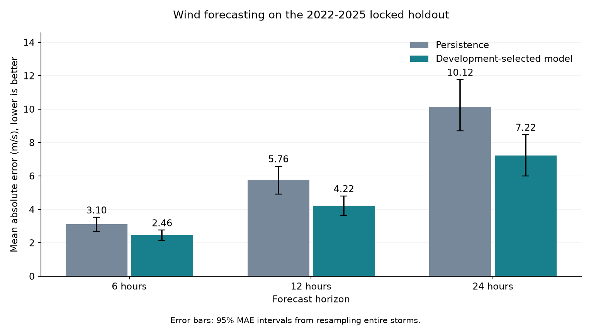

# Dự đoán tốc độ gió bão nhiệt đới

Dự án dùng dữ liệu quan trắc bão và môi trường khí tượng để dự đoán **tốc độ gió
sau 6, 12 và 24 giờ**. Câu hỏi chính: với thông tin đã có tại thời điểm hiện tại,
mô hình có dự đoán tốt hơn cách giữ nguyên tốc độ gió hiện tại hay không?

## 1. Đặt vấn đề

Cường độ gió thay đổi trong quá trình bão di chuyển và tương tác với môi trường.
Biết tốc độ gió hiện tại chưa đủ để biết bão sắp mạnh lên hay yếu đi.
Dự án xem xét cả lịch sử gió và các biến môi trường để tìm những tín hiệu liên quan
đến sự thay đổi này, so sánh mô hình và phân tích giới hạn của kết quả.

Đây là nghiên cứu khí tượng trên dữ liệu lịch sử, chưa phải hệ thống cảnh báo
đang vận hành hoặc dự án giao dịch tài chính.

## 2. Input và output

**Input tại thời điểm t:**
- Tốc độ gió tại t và tại t−6h, t−12h, t−18h.
- Vị trí, áp suất trung tâm, tốc độ/hướng di chuyển nếu có.
- Các biến ERA5 tại thời điểm hiện tại và các mốc lịch sử đã chọn:
  thành phần gió, độ ẩm, áp suất và các trường khí tượng liên quan.
- Các đặc trưng được tạo từ những quan sát trên.

**Output:** tốc độ gió, đơn vị m/s, tại t+6h, t+12h hoặc t+24h.
Mỗi horizon có một mô hình riêng. Ví dụ, từ lịch sử quan sát đến 12:00,
dự báo lần lượt gió lúc 18:00, 00:00 hôm sau và 12:00 hôm sau.

Không dùng điều kiện khí tượng thực tế trong tương lai làm input.
Bốn điểm cách nhau 6 giờ trải từ t−18h đến t, tức **18 giờ lịch sử**,
không phải cửa sổ lịch sử 24 giờ.

## 3. Dữ liệu

Dữ liệu hiện có kết hợp bản ghi bão Xweather với các trường ERA5 được mô tả
trong tài liệu của đồ án ban đầu.

| Thuộc tính | Giá trị |
|---|---|
| Quan sát gốc | 16.485 |
| Cột gốc | 56, gồm cả metadata và biến mục tiêu |
| Mã bão | 563 |
| Thời gian ghi nhận | 18/03/1980–13/11/2025 |
| Biến mục tiêu | pt_windSpeedMPS |

Nguồn tham khảo: [Xweather](https://www.xweather.com/docs/weather-api/endpoints/tropicalcyclones-archive),
[ERA5 single levels](https://cds.climate.copernicus.eu/datasets/reanalysis-era5-single-levels)
và [ERA5 pressure levels](https://cds.climate.copernicus.eu/datasets/reanalysis-era5-pressure-levels).

CSV gốc được giữ local tại data/raw/dataset.csv. Thư mục được cung cấp không có
script crawl gốc đầy đủ. Pipeline hiện tại dùng lại CSV đã thu thập, không nhận
là đã tái lập hoàn chỉnh bước lấy dữ liệu từ nhà cung cấp.

## 4. Tiền xử lý

1. Đọc thời gian theo định dạng ngày–tháng–năm, sắp xếp theo bão và thời điểm.
2. Loại các quan sát tương đương bị lặp. Nếu cùng bão/thời điểm nhưng dữ liệu còn
   mâu thuẫn, loại những dòng đó thay vì tự chọn một nhãn hoặc lấy trung bình.
3. Loại thông tin có thể tiết lộ tương lai: gió cực đại cả vòng đời, thời điểm
   kết thúc và các thống kê cuối cùng của bão.
4. Ghép lịch sử và target theo **đúng giờ của cùng cơn bão**, không giả định
   “dòng kế tiếp” luôn tương đương 6 giờ sau và không nội suy từ tương lai.
5. Học cách điền giá trị thiếu và chuẩn hóa **chỉ từ tập train của từng fold**.

Sau làm sạch: bỏ **1.111 quan sát tương đương** và **6 dòng ở 3 mốc mâu thuẫn**,
còn **15.368 quan sát** trước bước tạo lịch sử và target.
Xem [kiểm tra dữ liệu](reports/data_audit.json).

## 5. Feature engineering

| Nhóm | Mục đích |
|---|---|
| Lag features theo đúng giờ | Biểu diễn trạng thái trước đó của cùng bão |
| Trung bình, độ lệch chuẩn của gió | Tóm tắt mức gió và biến động gần đây |
| Thay đổi gió trong 6 giờ | Mô tả xu hướng mạnh lên hoặc yếu đi |
| Độ lớn vector gió ở các tầng | Tổng hợp hai thành phần u/v |
| Wind shear giữa 850 và 200 hPa | Mô tả chênh lệch vector gió giữa hai tầng |
| Sin/cos cho giờ, tháng và kinh độ | Giữ tính chu kỳ của các biến này |

Mã bão chỉ dùng để tổ chức chuỗi và kiểm tra chia tập, không đưa vào mô hình như
một đặc trưng số. Không dùng trực tiếp bảng preprocessing toàn cục của bản cũ.

## 6. Thiết kế thực nghiệm

| Phần dữ liệu | Giai đoạn | Vai trò |
|---|---|---|
| Development | Trước 2019 | Chọn mô hình và siêu tham số |
| Calibration | 2019–2021 | Ước lượng khoảng dự đoán |
| Holdout test | 2022–2025 | Đánh giá cuối cùng |

Trong development, các cửa sổ validation là 2004–2008, 2009–2013 và 2014–2018.
Mỗi lần fit chỉ dùng nhãn trước cửa sổ validation. Loại những mẫu vắt qua ranh giới
lịch sử/nhãn, và không để cùng mã bão xuất hiện ở cả train và validation.

Chọn mô hình theo **MAE trung bình trên các cửa sổ validation**, không chọn lại
bằng kết quả test. Mọi mô hình được đánh giá trên cùng origin/target ở mỗi horizon.

## 7. Mô hình

| Mô hình | Ý tưởng |
|---|---|
| Persistence | Gió tương lai bằng gió hiện tại |
| Linear trend | Kéo dài xu hướng thay đổi gió trong 6 giờ gần nhất |
| ElasticNet | Hồi quy tuyến tính có regularization |
| Random Forest | Kết hợp nhiều cây hồi quy |
| HistGradientBoosting | Học nối tiếp các cây để cải thiện dự đoán |
| PyTorch MLP | Mạng neural trên đặc trưng dạng bảng |
| PyTorch LSTM | Mạng neural xử lý chuỗi theo thời gian |

LSTM dùng tập biến chuỗi cố định; các mô hình khác có thể dùng bộ đặc trưng rộng
hơn. Vì vậy đây là so sánh **hệ thống mô hình–đặc trưng**, không phải thí nghiệm
chỉ thay kiến trúc và giữ mọi input giống nhau.

## 8. Đánh giá và kết quả

- **MAE:** sai số tuyệt đối trung bình, diễn giải trực tiếp theo m/s.
- **RMSE:** phạt mạnh hơn những dự đoán sai nhiều.
- **R²:** mức độ giải thích biến thiên của tốc độ gió.
- So sánh với persistence, kiểm tra sai số khi gió mạnh, bias và độ phủ khoảng dự đoán.

Đây là kết quả của **benchmark mới với target tương lai đã thống nhất**:

| Horizon | Mẫu test | Persistence MAE | Mô hình được chọn MAE | Giảm MAE |
|---|---:|---:|---:|---:|
| 6 giờ | 643 | 3,1042 m/s | 2,4575 m/s | 20,8% |
| 12 giờ | 606 | 5,7624 m/s | 4,2161 m/s | 26,8% |
| 24 giờ | 538 | 10,1245 m/s | 7,2201 m/s | 28,7% |

HistGradientBoosting được chọn ở cả ba horizon từ kết quả validation.

[Bảng tất cả mô hình](reports/benchmark/holdout_metrics.csv).
Khoảng bất định của MAE được tính bằng cách lấy mẫu lại **cả cơn bão**,
thay vì coi từng quan sát liên tiếp là độc lập.

## 9. Phân tích và giới hạn

- Persistence là baseline mạnh, đặc biệt ở horizon ngắn.
- Mô hình được chọn giảm MAE trên cả ba horizon của holdout lịch sử này.
- Bỏ lag features hoặc ERA5 làm MAE validation tăng ở cả ba horizon với cấu hình
  đang cố định: [bảng ablation](reports/benchmark/development_ablations.csv).
- Khoảng dự đoán đặt mức danh nghĩa 90% chỉ đạt **80,9–83,2%** coverage trên test.
  Calibration chưa giữ được mức danh nghĩa khi chuyển sang giai đoạn khác.
- Sai số tăng khi dự báo xa hơn; diễn biến gió mạnh/biến động nhanh còn khó.

ERA5 là dữ liệu tái phân tích lịch sử, chưa xác minh là thông tin sẵn có đúng lúc
phát hành dự báo. Timestamp gốc không có offset rõ; cách diễn giải UTC được giữ
theo bảng feature cũ nhưng chưa đối chiếu được phản hồi gốc từ nhà cung cấp.
Kết quả vì vậy chưa chứng minh được chất lượng dự báo thời gian thực.

## 10. Bản ban đầu và bản hiện tại khác nhau thế nào?

**Ban đầu:** notebook thực nghiệm với các mô hình ML và TensorFlow/Keras.
Đồ án gốc được trình bày là dự án nhóm 5 thành viên. Phần lớn code được thực hiện
bởi người phát triển repo này; phân công thuyết trình không phản ánh đầy đủ đóng góp code.

**Phần mở rộng hiện tại:** tổ chức pipeline, căn lại target tương lai, thêm
walk-forward validation, baseline, PyTorch, ablation và kiểm chứng kết quả.
API/demo và Docker đã được gỡ để repo tập trung vào nghiên cứu mô hình.

Điểm cũ không so trực tiếp với bảng mới: nhánh ML cũ dự đoán nhãn cùng dòng,
còn nhánh DL dùng chuỗi để dự đoán một quan sát sau đó.

## 11. Đọc code

- **notebooks/modeling.ipynb:** notebook nghiên cứu hiện tại; gọi hàm từ src, fit lại
  mô hình đã chốt và đọc bảng/biểu đồ phân tích lỗi theo từng bước.
- **src/:** pipeline hiện tại theo dữ liệu, features, chia tập, mô hình và đánh giá.
- **configs/research.json:** cấu hình benchmark.
- **reports/benchmark/:** kết quả tổng hợp và biểu đồ.
- **reports/analysis/:** phân tích bổ sung từ notebook, không dùng để chọn lại mô hình.
- **tests/:** kiểm thử target, leakage và lưu/nạp model.

Dữ liệu gốc, model và prediction từng dòng chỉ giữ local. Khi đã cài package và
chuẩn bị CSV, có thể chạy:

    python main.py train --data data/raw/dataset.csv --config configs/research.json --output reports/runs/new-run --evaluate-holdout

Benchmark đã công bố được giữ nguyên. Đợt dọn cấu trúc này không phải một lần
huấn luyện mới. Dự án có kỹ thuật chuyển sang nghiên cứu time series khác,
nhưng chưa có dữ liệu tài chính hoặc trading backtest.
